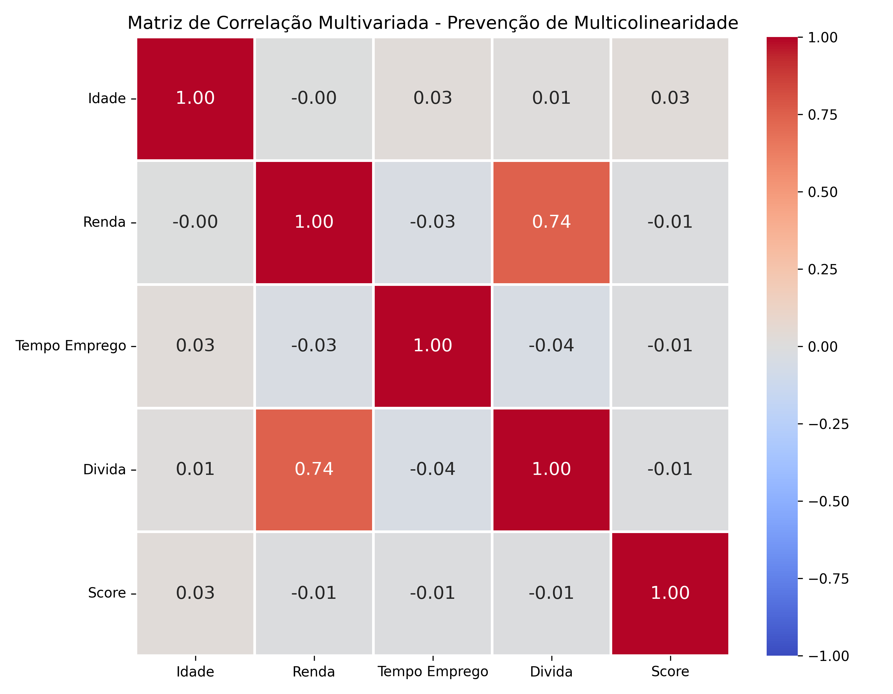

# TP2 — Credit Risk Cleaning Pipeline
## Projeto acadêmico de Ciência de Dados.
O projeto implementa um pipeline completo em Python para diagnóstico, saneamento avançado, tratamento de anomalias estatísticas e feature engineering em uma base de risco de crédito corrompida (`clientes_credito_bruto.csv`), entregando um dataset perfeitamente higienizado e padronizado (Model-Ready) para modelagem preditiva.

---

## Diagnóstico inicial da base

A base bruta possui **2.500 registros × 8 colunas** (`id_cliente`, `idade`, `renda_mensal`, `tempo_emprego_anos`, `divida_total`, `score_credito`, `estado_civil` e `escolaridade`), apresentando **625 valores ausentes** (25% dos registros afetados) e anomalias severas de domínio.
<div align="center">

| Variável | Nulos (Abs.) | Nulos (%) | 
| :--- | :---: | :---: | 
| **`idade`** | 100 | 4,0% | 
| **`renda_mensal`** | 150 | 6,0% | 
| **`tempo_emprego_anos`** | 125 | 5,0% | 
| **`estado_civil`** | 125 | 5,0% | 
| **`escolaridade`** | 125 | 5,0% | 
| **Total** | **625** | **25,0%** | 

</div>

---

## Arquitetura do pipeline

**Fase 1 — Diagnóstico e imputação de valores ausentes (missing data)**
   * **Análise exploratória:** mapeamento de tipos de dados, estatísticas descritivas e percentual de nulidade por atributo, optando pela preservação dos registros para evitar perda de 25% da amostra.
   * **Imputação categórica (Moda):** preenchimento de `estado_civil` (Casado) e `escolaridade` (Médio).
   * **Imputação univariada robusta (Mediana):** preenchimento de `idade` (38,30 anos) e `tempo_emprego_anos` (3,20 anos) para evitar viés causado por outliers.
   * **Imputação multivariada (`KNNImputer`):** estimativa da `renda_mensal` utilizando `n_neighbors=5` com base na proximidade entre `idade`, `tempo_emprego_anos` e `divida_total`, zerando os 625 nulos da base.

**Fase 2 — Filtragem de anomalias e tratamento de outliers (Tukey IQR / capping)**
   * **Regras de negócio e anomalias biológicas:** remoção de **15 registros** com `idade < 18` ou `idade > 120`, adequando a base às exigências legais de concessão de crédito e reduzindo o dataset para **2.485 registros válidos**.
   * **Limites de Tukey:** truncamento do limite inferior em `0.00` (impossibilidade de renda, dívida ou tempo de emprego negativos) e definição de teto de domínio em **35,00 anos** para `tempo_emprego_anos` (referência previdenciária, preservando clientes estáveis e restringindo o corte a apenas 7 outliers extremos).
   * **Winsorization (capping via `np.clip`):** substituição dos valores excedentes pelos respectivos limites superiores (`R$ 11.765,96` para `renda_mensal`, `R$ 35.021,23` para `divida_total` e `35,00` anos para `tempo_emprego_anos`).

**Fase 3 — Engenharia de features e análise multivariada**
   * **Discretização (binning):** criação da variável categórica ordinal `faixa_etaria` via `pd.cut` (`Jovem`: 18–29 anos [512], `Adulto`: 30–59 anos [1.876], `Sênior`: 60+ anos [97]).
   * **Escalonamento (feature Scaling):** normalização no intervalo `[0, 1]` via `MinMaxScaler` nas variáveis contínuas (`idade_scale`, `renda_scale`, `tempo_emprego_scale`, `divida_scale` e `score_scale`).
   * **Matriz de correlação de Pearson:** identificação de forte correlação positiva (`0.74`) entre `renda_scale` e `divida_scale` (clientes com maior renda acessam maiores limites de crédito) e ausência de multicolinearidade crítica entre os demais preditores.
<p align="center">
  
</p>

**Fase 4 — Limpeza estrutural e exportação (`clientes_credito_higienizado.csv`)**
   * Descarte das colunas brutas pré-capping, padronização semântica dos nomes das colunas e exportação do dataset final higienizado com **2.485 linhas × 14 colunas**.

---

## Estrutura do repositório

```text
├── tp2_credit_risk_cleaning_pipeline.ipynb
├── clientes_credito_bruto.csv
├── clientes_credito_higienizado.csv
├── heatmap_correlacoes_TP2.png
├── requirements.txt
└── README.md
```

## Como executar localmente

### 1. Instalar as dependências

```bash
pip install -r requirements.txt
```

### 2. Executar o notebook

Abra o arquivo `tp2_credit_risk_cleaning_pipeline.ipynb` no **Jupyter Notebook**, **VS Code** ou **Google Colab** e execute as células sequencialmente para reproduzir o diagnóstico, as imputações, o tratamento de outliers, o heatmap de correlações e a geração do arquivo `clientes_credito_higienizado.csv`.

---

## Tecnologias utilizadas

* **Linguagem:** Python 3
* **Manipulação e análise de dados:** `pandas`, `numpy`
* **Pré-processamento e Machine Learning:** `scikit-learn` (`KNNImputer`, `MinMaxScaler`)
* **Visualização de dados:** `matplotlib`, `seaborn`
